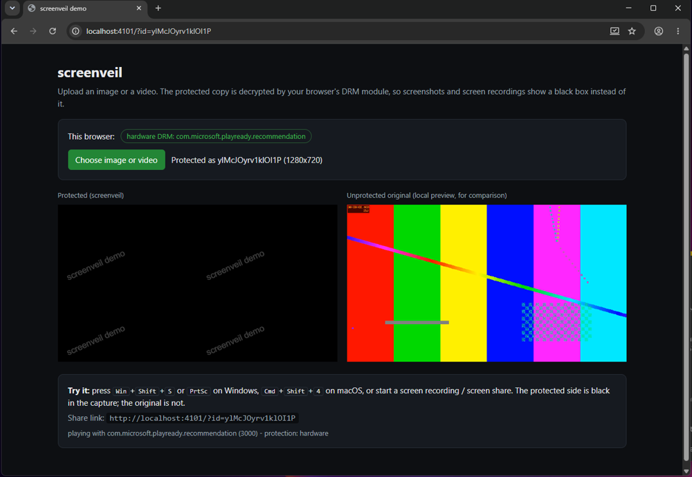
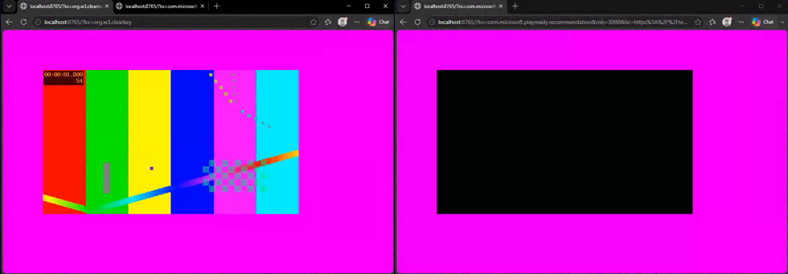

# screenveil

Open-source DRM for images and videos on the web. Protected media plays normally on screen,
but screenshots, screen recordings and screen sharing capture a black box instead.



*A real Windows screenshot (GDI `CopyFromScreen`) of the demo page in Chrome 155. Left: the video protected by
screenveil. Right: the same file as a plain `<video>`. Only the watermark, a normal page element, survives on the left.*

screenveil has two parts:

- **Browser library** (`screenveil`): `protect(element, { manifest })` or `<screenveil-media>`. It picks the
  strongest DRM system the browser has, fetches a license and plays the media through the browser's DRM module.
- **Node server kit** (`screenveil/server`): encrypts images and videos (CENC / CBCS, written from scratch, no
  Shaka or Bento4 needed), stores keys, proxies license requests, and exposes everything as a Web API you can
  mount in Express or plain `http`. It also ships a CLI and a demo.

## How the black screen works

There is no JavaScript API that can stop a screenshot. What does work is the browser's Encrypted Media
Extensions (EME). When encrypted media is decrypted by a real DRM module (PlayReady, Widevine or FairPlay),
the browser hands the frames to the operating system as a protected surface. The OS compositor shows it on
the monitor but leaves it out of captures. I measured this with GDI screenshots, GDI screen recording and
browser `getDisplayMedia` (the API behind web screen sharing). Desktop tools built on the same Windows capture
APIs (Snipping Tool, OBS, Teams, Discord) should behave the same, but I did not test them one by one.

screenveil turns any image or video into an encrypted H.264 MP4. An image becomes a short, looping
still-frame video that looks exactly like an ``. The library then plays it through EME.

```
your server                                         browser
-----------                                         -------
photo.jpg ──ffmpeg──► H.264 fMP4 ──encrypt──►  media.mp4 ──► MediaSource ──► CDM (PlayReady/Widevine/FairPlay)
                                   (AES key)   manifest.json                        │
key store ◄── license proxy ◄──────────────── license request ◄─────────────────────┘
               (checks a signed token)                                 frames go to a protected OS surface
                                                                       → black in screenshots/recordings
```

## What I verified, and what I didn't

Tested on Windows 11 (26200), Chrome 155 and Edge 154, using a real OS screenshot (GDI), a GDI screen recording
(`ffmpeg -f gdigrab`) and a full-screen `getDisplayMedia` recording from another browser window:

| Browser | DRM path chosen by screenveil | Screenshot | Screen recording |
| --- | --- | --- | --- |
| Edge 154 / Windows 11 | PlayReady SL3000 (hardware) | black | black |
| Chrome 155 / Windows 11 | PlayReady SL3000 (hardware) | black | black |
| Chrome 155 / Windows 11 | Widevine L3 (software, forced) | black, **unless page CSS breaks it** (see [Styling rules](#styling-rules)) | black |
| Any | Clear Key | **visible** | **visible** |



*A frame from a full-screen `getDisplayMedia` recording. Left: Clear Key (no real DRM), captured. Right: the
same encrypted file licensed through PlayReady SL3000, black.*

Because Clear Key gives no capture protection, the player refuses it by default (`minProtection: 'software'`).

**Not tested by me:** Safari/FairPlay on macOS and iOS, Android Chrome (Widevine L1), Firefox, ChromeOS and Linux.
Those platforms are known to protect DRM output in their own ways, but behaviour varies with OS, GPU and driver.
Linux desktops generally have only software Widevine with no protected surfaces, so captures there likely show the
media. Test on the platforms your users have before relying on this.

## Quick start (5 minutes, dev mode)

You need Node 20+ and [ffmpeg](https://ffmpeg.org/download.html) on your PATH.

```sh
git clone https://github.com/RamiMohamed12/screenveil
cd screenveil
npm install          # also builds
npm run dev          # = screenveil serve --dev
```

Open <http://localhost:8080> in Chrome or Edge, upload an image or video, then take a screenshot
(<kbd>Win</kbd>+<kbd>Shift</kbd>+<kbd>S</kbd>) or start a screen recording.

Dev mode needs no DRM contract. Keys come from Google's public Widevine UAT key server, and licenses come from
Google's Widevine UAT proxy and Microsoft's PlayReady test server. **Anyone can obtain those keys, so dev mode is
for trying screenveil, not for protecting real content.** See [Going to production](#going-to-production).

## Install

```sh
npm install github:RamiMohamed12/screenveil
```

(It is not on the npm registry yet. Once it is, `npm install screenveil` will work too.)

## Browser usage

```js
import { protect } from 'screenveil';

// Replace an  (or fill any container) with protected playback.
const player = await protect('#hero-photo', {
  manifest: '/api/assets/abc123/manifest.json',
  token: await getLicenseTokenFromYourBackend('abc123'),
});

console.log(player.protection); // 'hardware' | 'software'
```

Or with the custom element:

```html
<script type="module">
  import { defineElement } from 'screenveil';
  defineElement();
</script>

<screenveil-media manifest="/api/assets/abc123/manifest.json" token="…" style="width: 640px"></screenveil-media>
```

Or without a bundler: copy `dist/screenveil.global.js` (also attached to each GitHub release), add
`<script src="screenveil.global.js"></script>`, and use `window.ScreenVeil.protect(...)` or `<screenveil-media>`.

### Player options

| Option | Default | |
| --- | --- | --- |
| `manifest` | required | Manifest URL or object. |
| `token` | none | String or `() => Promise<string>`. Sent as `Authorization: Bearer …` with license requests. |
| `minProtection` | `'software'` | `'hardware'` to accept only hardware DRM; `'none'` also allows Clear Key (not capture-proof). |
| `preferredSystems` | none | e.g. `['widevine', 'playready']`, used to break ties at the same protection level. |
| `drm` | from manifest | Per-system overrides: `{ widevine: { licenseUrl, headers } }`. |
| `fit` | `'contain'` | `'contain'`, `'cover'` or `'fill'`. |
| `controls`, `autoplay`, `muted`, `loop` | video: controls on | Images always autoplay, loop and stay muted. |
| `deterrence` | `{}` | `{ watermark: 'user@example.com', blockContextMenu: true, hideOnBlur: false }`, or `false`. |
| `unsupportedMessage` | built-in | Text shown when the browser has no suitable DRM. |

Events on the player: `ready`, `error` (`detail.code`: `unsupported`, `manifest`, `license`, `media`,
`output-restricted`) and `warning` (unsafe page styles, see below). `player.destroy()` releases everything.
`detectProtection()` tells you what the current browser would use without loading any media.

### Styling rules

With **hardware** DRM the picture stays black in captures no matter how you style the page. With **software**
DRM (Widevine L3, which Chrome uses when hardware DRM is unavailable), the browser can only keep the video out of
captures while it hands the video to the OS as its own overlay plane. I measured that each of these on the player
or any ancestor makes the video capturable again in Chrome:

- `border-radius` that clips the video (rounded corners)
- `opacity` below 1
- `transform` (even `rotate(0.5deg)`)
- `filter`

Overlays on top of the video, native controls and pausing were fine. screenveil forces safe styles on its own
elements, and `player.checkCaptureSafety()` lists offending ancestors (it also logs a console warning and fires a
`warning` event).

## Server usage

### Mount the Web API in Express (or plain `http`)

```js
import express from 'express';
import { createScreenVeilApi, licenseProxy, issueLicenseToken } from 'screenveil/server';

const app = express();
const TOKEN_SECRET = process.env.SCREENVEIL_TOKEN_SECRET; // 16+ chars

app.use(
  createScreenVeilApi({
    dataDir: './screenveil-data', // assets/<id>/{manifest.json,media.mp4}, keys/<id>.json (keep private)
    tokenSecret: TOKEN_SECRET,
    authorizeUpload: (req) => req.headers['x-admin-key'] === process.env.ADMIN_KEY,
    licenses: [
      licenseProxy({ system: 'widevine', url: process.env.WIDEVINE_LICENSE_URL, headers: (ctx) => ({ /* vendor auth */ }) }),
      licenseProxy({ system: 'playready', url: process.env.PLAYREADY_LICENSE_URL, headers: (ctx) => ({ /* vendor auth */ }) }),
    ],
  }),
);

// Your own route decides who may watch what, then hands out a short-lived token.
app.get('/my/token/:id', requireLogin, (req, res) => {
  res.json({ token: issueLicenseToken(TOKEN_SECRET, { contentId: req.params.id, subject: req.user.id, ttlSeconds: 300 }) });
});
```

Routes (default prefix `/api`):

| Method | Path | |
| --- | --- | --- |
| `POST` | `/assets?filename=photo.jpg[&kind=image\|video]` | Upload raw bytes. Transcodes, encrypts, returns `{ id, manifestUrl, manifest }`. Needs `authorizeUpload`. |
| `GET` | `/assets/:id/manifest.json` | Manifest (never contains the key). |
| `GET` | `/assets/:id/media.mp4` | Encrypted media, supports `Range`. Safe to put on a CDN. |
| `POST` | `/license/:system/:id` | CDM challenge in, license out. Checks the token, then calls the license provider. |
| `GET` | `/license/fairplay/:id/certificate` | FairPlay application certificate. |
| `POST` | `/assets/:id/token` | Optional token endpoint, enabled with the `issueToken` option (used by the demo). |

### Package files yourself

```js
import { protectFile, fileKeyStore } from 'screenveil/server';

const { manifest, key } = await protectFile('photo.jpg', './public/assets/photo1', {
  id: 'photo1',
  keyStore: fileKeyStore('./private/keys'),
  drm: {
    widevine: { licenseUrl: '/api/license/widevine/{id}' },
    playready: { licenseUrl: '/api/license/playready/{id}' },
  },
});
```

`media.mp4` and `manifest.json` are static files. Host them anywhere that supports HTTP range requests.
The lower-level `encryptFragmentedMp4()` is exported too, if you already produce fragmented H.264 MP4.

### CLI

```sh
screenveil protect photo.jpg --data ./screenveil-data     # writes assets/<id>/ and keys/<id>.json
screenveil serve --config ./screenveil.config.mjs         # Web API + demo page with your providers
screenveil serve --dev                                    # public test DRM servers, demo only
```

See [`examples/screenveil.config.mjs`](examples/screenveil.config.mjs) and
[`examples/express-server.mjs`](examples/express-server.mjs).

## Going to production

Browsers only trust licenses signed by the DRM vendors (Google for Widevine, Microsoft for PlayReady, Apple for
FairPlay), so no open-source project can ship its own production license server. What you need:

1. **A DRM license service.** EZDRM, Axinom, DRMtoday (castLabs), DoveRunner/PallyCon, BuyDRM, Irdeto, Verimatrix
   and others sell Widevine + PlayReady (+ FairPlay) licensing as a service. Most support "bring your own key"
   tokens, so you can keep screenveil's key store and pass `ctx.key` in the `licenseProxy` `headers` callback.
   Others generate keys for you; implement a `KeySource` that calls their key API.
2. **`licenseProxy()` per system**, pointed at the vendor. The browser only ever talks to your server, which
   checks the screenveil token before forwarding.
3. **Safari:** package with `scheme: 'cbcs'` and add a FairPlay provider with a `certificateUrl`. FairPlay needs
   Apple's FairPlay Streaming credentials. I haven't tested this path.
4. **Keys stay server-side.** `keys/` must never be web-served. Rotate the token secret like any other secret.

## Limitations (please read)

- **Cameras.** Nothing stops someone photographing the screen. The `watermark` option helps trace leaks.
- **Platform dependent.** The black capture comes from the OS and browser, not from screenveil. See the table above.
  Use `minProtection: 'hardware'` to show content only where it is strongest.
- **Software DRM is weaker.** Widevine L3 keys have been extracted in the past. Hardware DRM has not had that problem
  at scale.
- **Audio is not encrypted.** The packager encrypts video only.
- **H.264 only.** Every input is transcoded to H.264 with ffmpeg. Images are capped at 3840 px on the long edge,
  videos at 1920 px by default (`transcode.maxDimension`).
- **Media fetching.** The player loads `media.mp4` with range requests, buffering 30 s ahead. No adaptive bitrate.

## Development

```sh
npm install
npm test          # unit tests + encryption round-trips verified against ffmpeg's own CENC/CBCS decryptor
npm run typecheck
npm run build
```

The encryptor parses H.264 slice headers so they stay in the clear. Hardware decoders require that. The tests
cover CABAC and CAVLC streams, B-frames, weighted prediction and multi-slice frames in both schemes.

## License

[MIT](LICENSE)
